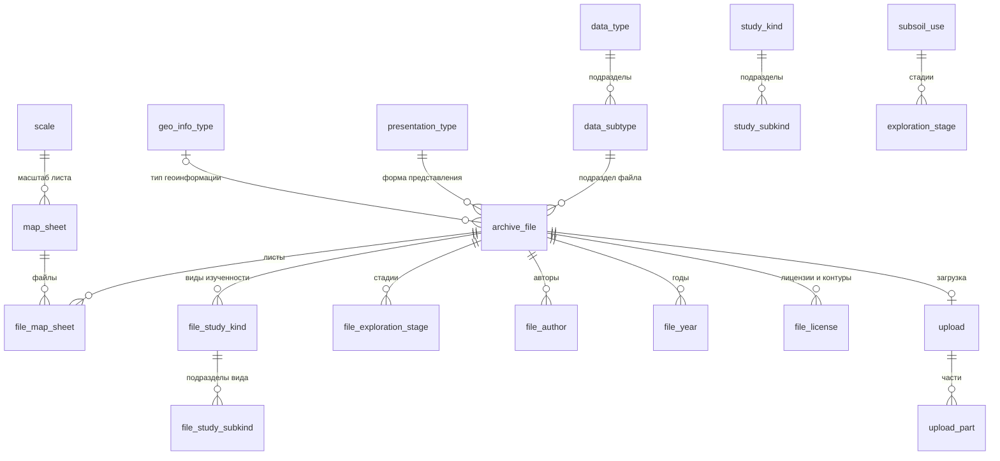

# geo-data-gis: модель данных и API

Описание архива геоданных geo-data-gis для разработчика, который подключается к нему со своей
логикой: что хранится, как устроены атрибуты документа, какие маршруты есть у API и что они
принимают и возвращают. Отдельно разобран контракт атрибутов загрузки — чтобы ответ модели можно
было передавать в загрузку без перекладки.

Собрано по коду сервера на 03.11.2026: схема `db/100_schema.sql`, `db/110_license_bbox.sql`,
установочные значения `db/200_seed.sql`, модели и проверки `app/catalog.py`, `app/files.py`,
`app/uploads.py`, `app/presets.py`, описание полей формы `app/form.py`, роли `access.manifest.json`.
Описание публичного API для людей ведётся в репозитории — `docs/INTEGRATION.md`, паспорта таблиц и
колонок — `db/900_doc.sql`.

## Содержание

1. [Общая картина](#1-общая-картина)
2. [Модель данных](#2-модель-данных)
3. [API: общие правила](#3-api-общие-правила)
4. [Справочники и описание формы](#4-справочники-и-описание-формы)
5. [Загрузка файла](#5-загрузка-файла)
6. [Контракт атрибутов загрузки](#6-контракт-атрибутов-загрузки)
7. [Поиск, карточка и скачивание](#7-поиск-карточка-и-скачивание)
8. [Журнал загрузок и шаблоны](#8-журнал-загрузок-и-шаблоны)
9. [Ошибки](#9-ошибки)
10. [Как готовить ответ модели](#10-как-готовить-ответ-модели)
11. [Приложение: установочные значения справочников](#11-приложение-установочные-значения-справочников)

## 1. Общая картина

Геологи загружают документы (отчёты, протоколы, первичную информацию, карты) с атрибутами и ищут
их по атрибутам и по области на карте. Клиенты — плагин QGIS и веб-страница приложения; оба
работают через одно и то же API.

| Что | Где | Кто пишет |
|---|---|---|
| Метаданные файлов, справочники атрибутов, листы, состояние загрузок, шаблоны | MS SQL, схема приложения `geo_data_gis` | только приложение |
| Тела файлов | S3-хранилище контура, ключ `files/<uuid>` | только приложение |
| Месторождения и рудные зоны | база РМБД (`RMINE_DATA`) | чужая база, только чтение |
| Номера лицензий и их контуры | база реестра лицензий (имя задаётся на сервере) | чужая база, только чтение |

Месторождения, рудные зоны и лицензии в базе приложения хранятся только ключами; названия
подтягиваются из источников при показе. Лицензии с РМБД не связаны.

## 2. Модель данных

### 2.1. Схема связей



Так же, как `file_author`, устроены `file_mineral`, `file_method`, `file_region`; `file_org` и
`file_ore_zone` хранят ключи РМБД без внешнего ключа.

### 2.2. Файл архива — `archive_file`

Одна строка — один файл: тело лежит в хранилище один раз, сколько бы значений ни было у его
многозначных атрибутов.

| Колонка | Тип | Обязательна | Смысл |
|---|---|---|---|
| `file_id` | bigint, identity | да | ключ файла во всём API |
| `file_name` | nvarchar(255) | да | имя файла, как его загрузили |
| `size_bytes` | bigint | да | размер, байты |
| `sha256` | char(64) | да | SHA-256 содержимого, строчные hex |
| `content_type` | nvarchar(255) | нет | MIME-тип |
| `s3_key` | nvarchar(1024) | да | ключ тела в хранилище; наружу не отдаётся |
| `status` | varchar(16) | да | `uploading` → `ready` или `aborted`; в поиске только `ready` |
| `data_subtype_id` | int → `data_subtype` | да | подраздел типа данных (тип — через подраздел) |
| `presentation_type_id` | int → `presentation_type` | да | форма представления |
| `geo_info_type_id` | int → `geo_info_type` | нет | тип геологической информации |
| `crs_authid` | nvarchar(64) | нет | система координат данных файла, например `EPSG:4326` |
| `uploaded_by` | nvarchar(128) | да | доменный логин загрузившего |
| `created_on` | datetime2 | да | начало загрузки |
| `completed_on` | datetime2 | только у `ready` | завершение загрузки |

### 2.3. Многозначные атрибуты — таблицы `file_*`

| Таблица | Значение | Ссылка | Особенность |
|---|---|---|---|
| `file_map_sheet` | `map_sheet_id` | `map_sheet` | лист заводится при первой загрузке по номенклатуре |
| `file_author` | `author_id` | `author` | автор заводится из формы загрузки |
| `file_mineral` | `mineral_id` | `mineral` | |
| `file_method` | `method_id` | `method` | |
| `file_region` | `region_id` | `region` | |
| `file_year` | `year` smallint | — | 1800…2100 в базе; API принимает до текущего года + 1 |
| `file_study_kind` | `study_kind_id` | `study_kind` | |
| `file_study_subkind` | `study_subkind_id` + `study_kind_id` | `study_subkind`, `file_study_kind` | составные внешние ключи: подраздел принадлежит своему виду, и этот вид выбран у файла |
| `file_exploration_stage` | `exploration_stage_id` | `exploration_stage` | |
| `file_org` | `org_id` | РМБД, без внешнего ключа | наличие проверяет API при загрузке |
| `file_ore_zone` | `ore_zone_id` | РМБД, без внешнего ключа | то же |
| `file_license` | `license_number` nvarchar(64) | реестр лицензий, без внешнего ключа | плюс снимок контура, см. 2.5 |

### 2.4. Справочники атрибутов

Все справочники — `{<name>_id int identity, name nvarchar(255), is_active bit}`. Значение не
удаляется, а выводится из оборота (`is_active = 0`): у старых файлов ссылка остаётся, в поиске
значение доступно, в загрузке — нет. `id` различаются между стендами — опирайтесь на
`GET /api/values`, а не на номера из этого документа.

| Таблица | Родитель | Уникальность | Как пополняется | Установочных значений |
|---|---|---|---|---|
| `data_type` | — | `name` | миграцией | 4 |
| `data_subtype` | `data_type_id` | (`data_type_id`, `name`) | миграцией | 98 |
| `geo_info_type` | — | `name` | миграцией | 4 |
| `study_kind` | — | `name` | миграцией | 2 |
| `study_subkind` | `study_kind_id` | (`study_kind_id`, `name`) | миграцией | 14 |
| `subsoil_use` | — | `name` | миграцией | 1 |
| `exploration_stage` | `subsoil_use_id` | (`subsoil_use_id`, `name`) | миграцией | 3 |
| `mineral` | — | `name` | миграцией | 5 |
| `method` | — | `name` | миграцией | 5 |
| `region` | — | `name` | миграцией | 5 |
| `presentation_type` | — | `name` | из формы загрузки (текстом) | нет |
| `author` | — | `name` | из формы загрузки (текстом) | нет |
| `scale` | — | `denominator` | миграцией | 7 (1:1 000 000 … 1:10 000) |

Перечни установочных значений — в [приложении](#11-приложение-установочные-значения-справочников).

### 2.5. Номенклатурные листы и контуры лицензий

`map_sheet` — лист разграфки: `nomenclature` (уникальна, например `N-57-XII`), `scale_id` и рамка
`min_lon`, `min_lat`, `max_lon`, `max_lat` в градусах WGS 84. Масштаб и рамка вычисляются из записи
листа при первой загрузке; их не вводят. Сдвоенные листы севернее 60° — `P-57,58`.

`file_license` кроме номера хранит снимок контура лицензии на момент загрузки (если загружающий не
снял флаг `assign_license_bbox`): `boundary_wkt` — объединённые актуальные полигоны лицензии в
WGS 84, и рамка `min_lon … max_lat` для отбора кандидатов. Всё `NULL` — границы не присвоены. В
поиске по карте файл, у которого контур есть у всех лицензий, сравнивается по контурам, иначе — по
листам.

### 2.6. Загрузки — `upload`, `upload_part`

`upload` — порционная загрузка файла: `upload_id` (GUID), `file_id` (один к одному),
`part_size` (сейчас 16 МиБ), служебный идентификатор многочастной загрузки в хранилище,
`created_on`, `updated_on`. `upload_part` — принятая часть: `part_number` 1…10000, `size_bytes`,
`etag` хранилища, `received_on`.

Жизненный цикл файла: `uploading` → `ready` (после `complete`) или `aborted` (отмена, несовпадение
размера или SHA-256 при сборке, 7 дней без активности).

### 2.7. Шаблоны — `preset`

Сохранённое состояние формы: `owner_login`, `tab` (`upload` или `download`), `name` (уникально у
владельца на вкладке), `payload` (JSON), `is_shared` (общий шаблон ставит только администратор).
`payload` — состояние формы, а не тело загрузки: в нём есть поля каскада (`data_type_id`,
`subsoil_use_id`), а значения пополняемых полей могут быть `id`.

### 2.8. Служебные таблицы

`log` — журнал работы приложения; `app_setting` и `setting_audit` — настройки хранилища, которые
задаёт администратор, и журнал их изменений. К атрибутам документов отношения не имеют.

### 2.9. Внешние источники (только чтение)

| Справочник API | Источник | Что читается |
|---|---|---|
| `organization` | РМБД, `md.organization` | `id`, `name` — месторождения |
| `ore_zone` | РМБД, `dbo.ore_zone` | `ore_zone_id`, `short_name`, `org_id` — рудные зоны и их месторождение |
| `license` | реестр лицензий, `geo.license_registry_extended_view` | `number`, статус (2 — аннулирована), `organization_name` |
| контур лицензии | реестр лицензий, `geo.polygon_geometry`, `geo.polygon_coordinate` | актуальные полигоны, координаты в ГСК-2011 или СК-42, пересчёт в WGS 84 |

### 2.10. Инварианты

- У учётной записи приложения нет `DELETE`: файлы из архива не удаляются, шаблон удаляется
  процедурой `preset_delete`.
- Справочное значение не удаляется — `is_active = 0`.
- `completed_on` заполнен тогда и только тогда, когда `status = 'ready'`.
- Повтор содержимого не запрещён: один и тот же SHA-256 можно загрузить снова; клиент заранее
  спрашивает `POST /api/uploads/conflicts`.

## 3. API: общие правила

- **Адрес.** `{BASE}` — адрес приложения на стенде с префиксом `/geo-data-gis`, например
  `{BASE}/api/attributes`.
- **Вход.** Доменная авторизация Windows (IIS), пароль в запросах не передаётся. Права — роль
  пользователя в приложении; сервису, который вызывает API сам, нужна своя учётная запись с ролью.
- **Формат.** JSON в UTF-8. Даты — ISO 8601 без часового пояса (время сервера). Ошибка — `{"detail": …}`
  (раздел 9).
- **Страницы.** `limit` (по умолчанию 250, не больше 1000) и `offset`; в ответе `rows`, `total`,
  `has_more`, `limit`, `offset`. Пустой ответ может содержать `reason` — почему пусто.
- **Схема.** `GET {BASE}/api/integration/openapi.json` — OpenAPI только публичных маршрутов;
  `GET {BASE}/api/integration/doc` — описание для людей (`docs/INTEGRATION.md`, история изменений
  контракта — его §7); `GET {BASE}/api/integration/changes` — история изменений приложения.
- **Стабильность.** Публичные маршруты в статусе beta. Ломающее изменение объявляется в §7
  описания, старый маршрут живёт не меньше 4 недель. Коды полей и `id` справочников стабильны,
  подписи могут меняться.

### Роли и функции

| Функция | viewer | operator | admin | Что даёт |
|---|---|---|---|---|
| `files.search` | ✓ | ✓ | ✓ | справочники, описание формы, поиск, карточка, шаблоны (чтение) |
| `files.download` | ✓ | ✓ | ✓ | скачивание, прямые ссылки |
| `files.upload` | | ✓ | ✓ | загрузка, проверка дублей |
| `presets.manage` | | ✓ | ✓ | сохранение и удаление своих шаблонов |
| `journal.own` | | ✓ | ✓ | журнал своих загрузок |
| `journal.all` | | | ✓ | журнал всех загрузок |

### Маршруты

| Метод и путь | Функция | Зачем |
|---|---|---|
| `GET /api/me` | любая роль | кто вошёл, роль, функции, версия сервера |
| `GET /api/attributes` | `files.search` | описание полей формы (раздел 4) |
| `GET /api/values` | `files.search` | значения всех справочников (раздел 4) |
| `POST /api/uploads/conflicts` | `files.upload` | есть ли в архиве файлы с тем же SHA-256 |
| `POST /api/uploads` | `files.upload` | начать загрузку: атрибуты, имя, размер, SHA-256 |
| `GET /api/uploads/{upload_id}` | `files.upload`, свой | состояние: принятые и недостающие части |
| `PUT /api/uploads/{upload_id}/parts/{n}` | `files.upload`, свой | передать часть |
| `POST /api/uploads/{upload_id}/complete` | `files.upload`, свой | собрать файл, сверить размер и SHA-256 |
| `DELETE /api/uploads/{upload_id}` | `files.upload`, свой (admin — любой) | отменить незавершённую загрузку |
| `GET /api/uploads` | `journal.own`; `scope=all` — `journal.all` | журнал загрузок |
| `POST /api/files/search` | `files.search` | поиск по атрибутам и области на карте |
| `GET /api/files/{file_id}` | `files.search` | карточка файла |
| `GET /api/files/{file_id}/content` | `files.download` | тело файла, `Range` для докачки |
| `GET /api/files/{file_id}/link` | `files.download` | временная прямая ссылка в хранилище |
| `GET /api/presets?tab=` | `files.search` | свои и общие шаблоны |
| `POST /api/presets` | `presets.manage` | сохранить шаблон |
| `DELETE /api/presets/{preset_id}` | `presets.manage` | удалить шаблон |

Внутренние маршруты веб-страницы (работают, но без обещания совместимости): `POST
/api/nomenclature/check` — проверка записи листов; `/api/settings*` — настройки хранилища для
администратора; `GET /health` — состояние подсистем.

## 4. Справочники и описание формы

### `GET /api/attributes`

Описание полей формы — источник правды о том, какие поля есть, какие обязательны и как связаны.

```json
{
  "fields": [
    {"code": "data_subtype_id", "title": "Подраздел типа данных", "group": "Основные настройки",
     "kind": "dictionary", "required": true, "multi": false, "source": "data_subtype",
     "parent": "data_type_id", "allow_custom": false, "search_code": "data_subtype_ids", "hint": "",
     "in_upload": true, "in_search": true, "upload_payload": true}
  ],
  "spatial_modes": [{"code": "inside", "title": "Лист целиком внутри области"}]
}
```

| Свойство | Смысл |
|---|---|
| `code` | ключ поля в `attributes` загрузки |
| `search_code` | ключ того же поля в фильтрах поиска (там все справочные — списки `*_ids`) |
| `kind` | `dictionary`, `text`, `year`, `nomenclature`, `flag` |
| `required` | обязательно при загрузке (в поиске обязательных нет) |
| `multi` | множественный выбор — список |
| `source` | ключ справочника в `/api/values` |
| `parent` | поле-родитель каскада |
| `allow_custom` | можно ввести значение не из списка — уходит текстом |
| `in_upload`, `in_search` | есть ли поле в форме загрузки и поиска |
| `upload_payload` | `false` — поле только для каскада, в тело загрузки не уходит |

### `GET /api/values`

```json
{
  "data_type": [{"id": 1, "name": "Отчет", "is_active": true}],
  "data_subtype": [{"id": 5, "name": "Протокол ГКЗ", "is_active": true, "parent_id": 2}],
  "scale": [{"id": 4, "name": "1:100 000", "denominator": 100000, "is_active": true}],
  "map_sheet": [{"id": 7, "name": "N-57-XII", "parent_id": 3}],
  "organization": [{"id": 901, "name": "ТСТ-А"}],
  "ore_zone": [{"id": 9101, "name": "Зона-1", "parent_id": 901}],
  "license": [{"id": "ТСТ 00001 БР", "name": "ТСТ 00001 БР", "organization_name": "ТСТ-А"}],
  "sources_unavailable": {}
}
```

- Ключи: `data_type`, `data_subtype`, `geo_info_type`, `study_kind`, `study_subkind`, `subsoil_use`,
  `exploration_stage`, `mineral`, `method`, `region`, `presentation_type`, `author`, `scale`,
  `map_sheet`, `organization`, `ore_zone`, `license`.
- `parent_id` — у подчинённых: `data_subtype` → `data_type`, `study_subkind` → `study_kind`,
  `exploration_stage` → `subsoil_use`, `ore_zone` → `organization`, `map_sheet` → `scale`.
- `map_sheet` — только листы, на которые уже есть загруженные файлы (для поиска).
- У `license` значение — номер (`id`); у аннулированных к `name` добавлено «(аннулирована)».
- Внешний источник не ответил — его список пуст, причина в `sources_unavailable`.

## 5. Загрузка файла

Файл передаётся частями по 16 МиБ с докачкой: обрыв связи не начинает загрузку заново.

1. **Проверка дублей (необязательно).** `POST /api/uploads/conflicts`
   `{"files": [{"file_name": "отчёт.pdf", "sha256": "…"}]}` → для каждого — уже загруженные файлы с тем
   же содержимым. Сервер дубли не запрещает, решает пользователь.
2. **Начало.** `POST /api/uploads` с телом
   `{"file_name", "size_bytes", "sha256", "content_type", "attributes"}` (раздел 6). Сервер проверяет
   атрибуты, заводит файл со статусом `uploading` и отвечает 201 состоянием загрузки.
3. **Части.** `PUT /api/uploads/{upload_id}/parts/{n}`, `n` = 1…`part_count`, тело — байты части
   ровно `part_size` (последняя — остаток), заголовок `X-Part-Sha256` — SHA-256 байтов части,
   обязателен. Ответ `{"part_number", "size_bytes", "etag"}`. Повтор той же части её заменяет.
4. **Докачка.** `GET /api/uploads/{upload_id}` → какие части ещё нужны (`missing_parts`).
5. **Завершение.** `POST /api/uploads/{upload_id}/complete` → `status: "ready"`, файл виден в поиске.
   Файл до 1 ГиБ перечитывается и сверяется по SHA-256, больший — по размеру (целостность
   обеспечена сверкой каждой части). Повтор безвреден.
6. **Отмена.** `DELETE /api/uploads/{upload_id}` → `{"ok": true}`. Незавершённая загрузка без
   активности 7 дней отменяется сама.

Состояние загрузки (ответ шагов 2, 4, 5):

```json
{
  "upload_id": "3f2c…", "file_id": 43, "file_name": "отчёт.pdf", "status": "uploading",
  "size_bytes": 40000000, "sha256": "…", "part_size": 16777216, "part_count": 3,
  "received_parts": [{"part_number": 1, "size_bytes": 16777216}], "missing_parts": [2, 3],
  "updated_on": "2026-11-03T12:00:00", "completed_on": null
}
```

Пределы: файл до 160 ГиБ (10 000 частей), операции с загрузкой — только тому, кто её начал.

## 6. Контракт атрибутов загрузки

Объект `attributes` в теле `POST /api/uploads`. Машиночитаемо — `FileAttributes` в OpenAPI;
лишний ключ — 422.

### 6.1. Названия в форме и `id` в запросе

- **Форма показывает название, а отправляет `id`.** Справочные поля в плагине и на странице —
  выпадающие списки. Пользователь видит `name` из `GET /api/values`, а в запрос уходит `id` того же
  значения. Поэтому в таблице ниже у справочных полей тип integer: подписи «Протокол ГКЗ» сервер не
  примет, только её `id`.
- **Исключения — поля, куда можно ввести своё значение** (`allow_custom`): «Представление
  информации» и «Автор» уходят текстом. «Номенклатура» — текстом (запись листа), «Лицензия» —
  номером (он же `id`), «Год» — числом.
- **В хранилище S3 атрибуты не попадают.** Там лежит только содержимое файла под служебным ключом
  `files/<случайный идентификатор>`. Атрибуты пишутся в таблицы базы приложения (раздел 2), а
  читаются через API — карточкой файла (раздел 7).
- **Ключи при записи и при чтении разные.** Карточка отдаёт по каждому значению и `id`, и `name`:
  `"data_subtype": {"id": 5, "name": "Протокол ГКЗ"}`, `"regions": [{"id": 1, "name": "Камчатский
  край"}]`. Соответствие — столбец «В карточке».
- **Если модель отвечает названиями,** `id` находится по `name` в `GET /api/values`. Подразделы
  уникальны только внутри своего родителя: «Дело скважины» есть и у типа «Отчет», и у типа
  «Первичная геологическая информация». Поэтому подраздел ищется парой «тип + подраздел» — так же
  подраздел изученности и стадия. Остальные названия уникальны во всём справочнике.

### 6.2. Поля

Обязательность:

- **да** — ключ обязателен, без него 422;
- **да, ≥ 1** — ключ можно опустить (умолчание `[]`), но пустой список — 400;
- **нет** — можно опустить.

В JSON Schema обязательны только `data_subtype_id` и `presentation_type`; ещё шесть непустых
списков требует проверка сервера. Обязательность берите из `required` в `/api/attributes`.

| Подпись в форме | Ключ | Тип | Обязательно | По умолчанию | Значения, правила и связи | В карточке |
|---|---|---|---|---|---|---|
| **Основные настройки** | | | | | | |
| Тип данных → Подраздел типа данных | `data_subtype_id` | integer | да | — | `id` из `data_subtype`, одно действующее значение. «Тип данных» выбирается первым и сужает список подразделов; в тело уходит только подраздел. | `data_subtype.id` (тип — `data_type`) |
| Представление информации | `presentation_type` | string ≤ 255 | да | — | Текст; известные — `name` из `presentation_type`. Пополняемый справочник: новый текст заводит новое значение. Пустая строка — 400. | `presentation_type.name` |
| Тип геологической информации | `geo_info_type_id` | integer или null | нет | `null` | `id` из `geo_info_type`, одно значение. | `geo_info_type.id` |
| Вид ПИ | `mineral_ids` | integer[] | нет | `[]` | `id` из `mineral`. | `minerals[].id` |
| Методы | `method_ids` | integer[] | нет | `[]` | `id` из `method`. | `methods[].id` |
| **Область изучения** | | | | | | |
| Вид изученности | `study_kind_ids` | integer[] | да, ≥ 1 | `[]` | `id` из `study_kind`. | `study_kinds[].id` |
| Подраздел вида изученности | `study_subkind_ids` | integer[] | нет | `[]` | `id` из `study_subkind`; `parent_id` каждого должен быть среди `study_kind_ids`, иначе 400. | `study_subkinds[].id` |
| **Разведка** | | | | | | |
| Вид пользования недрами → Стадия разведки | `exploration_stage_ids` | integer[] | да, ≥ 1 | `[]` | `id` из `exploration_stage`. «Вид пользования недрами» только сужает список стадий, в тело не входит; связь стадии с видом сервер **не проверяет**. | `exploration_stages[].id` |
| **Листы** | | | | | | |
| Номенклатура | `nomenclatures` | string[] ≤ 500 | да, ≥ 1 | `[]` | `N-57`, `N-57-XII`, `N-57-144`, `N-57-144-А`, сдвоенный — `P-57,58`. Неразобранная запись — 400 с причиной. Масштаб выводится из записи. | `map_sheets[].name` |
| Система координат данных | `crs_authid` | string ≤ 64 или null | нет | `null` | `EPSG:4326`; вид `^[A-Za-z]+:\d+$`, иначе 400. | `crs_authid` |
| **Добыча и рудные зоны** | | | | | | |
| Регион | `region_ids` | integer[] | да, ≥ 1 | `[]` | `id` из `region`. | `regions[].id` |
| Месторождение | `org_ids` | integer[] | нет | `[]` | `id` из `organization` (внешний источник). | `organizations[].id` |
| Рудная зона | `ore_zone_ids` | integer[] | нет | `[]` | `id` из `ore_zone`; если `org_ids` не пуст, каждая зона должна относиться к одному из них, иначе 400. | `ore_zones[].id` |
| Лицензия | `license_numbers` | string[] | нет | `[]` | Номер — `id` из `license`; сверка с реестром без учёта регистра; приписку «(аннулирована)» не передавать. | `licenses[].id` |
| Присваивать координаты лицензии | `assign_license_bbox` | boolean | нет | `true` | Решает загружающий, не модель. При `true` с лицензиями сервер берёт их контуры; реестр недоступен — 503. | `licenses[].bbox` не `null` |
| **Дополнительная информация** | | | | | | |
| Год | `years` | integer[] | да, ≥ 1 | `[]` | 1800 … текущий год + 1, вне диапазона — 400. | `years` |
| Автор | `authors` | string[] ≤ 100 | да, ≥ 1 | `[]` | «Фамилия И.О.», как на титуле; известные — `name` из `author`. Пополняемый справочник, каждый ≤ 255 символов. | `authors[].name` |

Поля формы, которых нет в теле: «Тип данных» (`data_type_id`) и «Вид пользования недрами»
(`subsoil_use_id`) только сужают списки; «Масштаб» (`scale_ids`) и «Имя файла содержит»
(`file_name`) есть только в поиске. Передать их в `attributes` — 422.

### 6.3. Что означает каждое поле

Описание для того, кто заполняет поле по документу. Примеры значений — из установочных
справочников (раздел 11); действующие — `GET /api/values`.

- **Тип данных → Подраздел типа данных** — что это за документ. Типы: «Отчет» (геологический
  отчёт, ТЭО, годовой отчёт, баланс…), «Протокол» (ГКЗ, ТКЗ, НТС…), «Первичная геологическая
  информация» (журналы, акты, каталоги, паспорта скважин, снимки…), «Карты» (разрез, план, схема,
  приложение). Определяется по титулу и содержанию.
- **Представление информации** — в какой форме представлена информация в файле. Установочных
  значений нет: справочник пополняют пользователи. Лучше выбрать из действующих, новое — только
  когда подходящего нет.
- **Тип геологической информации** — первичная (полевые наблюдения и измерения),
  интерпретированная (результаты обработки и выводы), обе сразу или «Нет сведений».
- **Вид ПИ** — полезные ископаемые, о которых документ: Au, Ag, Cu, Pb, Zn.
- **Методы** — методы работ, результаты которых в документе: каротаж скважин, электроразведка,
  гидрогеология и инженерная геология и т. п.
- **Вид изученности** — к какой области работ относится документ: геологическая или
  геофизическая. **Подраздел** уточняет её (тектоника, минералогия, петрография…; магниторазведка,
  электроразведка…) и выбирается только внутри отмеченных видов.
- **Вид пользования недрами → Стадия разведки** — на какой стадии работ получен документ. Сейчас
  вид один — «Разведка и добыча», стадии ГРР, ЭРР, ОРР.
- **Номенклатура** — номера листов топографической разграфки, на территорию которых приходится
  документ. По ним файл находится поиском по карте. Масштаб листа выводится из записи: `N-57` —
  1:1 000 000; после него буква А…Г (`N-57-А`) — 1:500 000, римский номер I…XXXVI (`N-57-XII`) —
  1:200 000, арабский 1…144 (`N-57-144`) — 1:100 000; дальше А…Г — 1:50 000, а…г — 1:25 000,
  1…4 — 1:10 000.
- **Система координат данных** — в какой системе координат пространственные данные файла (растр,
  вектор), кодом вида `EPSG:4326`. У документа без координат не заполняется.
- **Регион** — субъект РФ, к территории которого относится документ.
- **Месторождение** и **Рудная зона** — объекты из базы месторождений; список рудных зон зависит от
  выбранных месторождений.
- **Лицензия** — номер лицензии на пользование недрами, как в реестре лицензий.
- **Присваивать координаты лицензии** — не свойство документа, а настройка поиска: файл ищется по
  карте в границах лицензии, а не по листам. Модель это поле не заполняет.
- **Год** — год или годы, к которым относится документ; отчёт может охватывать несколько лет.
- **Автор** — авторы документа: фамилия и инициалы, как на титуле.

### 6.4. Связи и приведение значений

```text
data_type ──────────► data_subtype_id          (в теле только подраздел)
study_kind_ids ─────► study_subkind_ids        (проверяется)
subsoil_use ────────► exploration_stage_ids    (в теле только стадии, не проверяется)
org_ids ────────────► ore_zone_ids             (проверяется, если org_ids не пуст)
license_numbers ────► assign_license_bbox
nomenclatures ──────► масштаб, рамка листа     (выводится)
```

Что сервер приводит сам: убирает повторы в списках; схлопывает пробелы в тексте и отбрасывает
пустых авторов и лицензии; приводит запись листа (регистр, кириллические двойники латинских букв —
кириллическая «Н» станет латинской `H`, это другой пояс, а не `N`); `crs_authid: ""` → `null`.
Типы принимаются мягко (`"5"` → 5, `"false"` → `false`), но `2020.5` вместо целого и `null` вместо
списка — 422.

Минимальный проходящий `attributes` (`id` условные):

```json
{
  "data_subtype_id": 5,
  "presentation_type": "Текст",
  "study_kind_ids": [1],
  "exploration_stage_ids": [1],
  "nomenclatures": ["N-57-XII"],
  "region_ids": [1],
  "years": [2020],
  "authors": ["Иванов И.И."]
}
```

## 7. Поиск, карточка и скачивание

### `POST /api/files/search`

```json
{
  "filters": {"data_type_ids": [1], "years": [2020], "nomenclatures": ["N-57-XII"], "file_name": "отчёт"},
  "spatial": {"polygon_wkt": "POLYGON((160 54, 163 54, 163 56, 160 56, 160 54))",
              "mode": "partial", "distance_m": null, "min_intersection_ratio": 0.25},
  "limit": 250,
  "offset": 0
}
```

- Фильтры: ИЛИ внутри поля, И между полями. Ключи — `search_code` из `/api/attributes`:
  `data_type_ids`, `data_subtype_ids`, `presentation_type_ids`, `geo_info_type_ids`, `mineral_ids`,
  `method_ids`, `study_kind_ids`, `study_subkind_ids`, `subsoil_use_ids`, `exploration_stage_ids`,
  `nomenclatures`, `scale_ids`, `region_ids`, `org_ids`, `ore_zone_ids`, `license_numbers`, `years`,
  `author_ids`, `file_name` (часть имени без учёта регистра).
- В поиске форма представления и авторы — `id` (`presentation_type_ids`, `author_ids`), а не текст,
  как в загрузке.
- `nomenclatures`: лист находит и сдвоенный, в который входит (`P-57` → `P-57,58`), сдвоенный — свои
  половины; вложенные листы не находятся (`N-57` не находит `N-57-XII`).
- `spatial`: полигон WKT `POLYGON` или `MULTIPOLYGON` в градусах EPSG:4326, до 20 000 вершин.
  `mode`: `inside` (лист целиком внутри), `partial` (пересекает, но не целиком), `outside` (не
  пересекается), `touches`, `contains_centroid`, `within_distance` (нужен `distance_m`, до
  500 000 м). `min_intersection_ratio` 0…1 — минимальная доля площади листа в области (для
  `partial` и `outside`).
- Область файла: контуры лицензий, если они присвоены всем его лицензиям, иначе — листы номенклатуры.
- Сортировка — по времени завершения загрузки, новые сверху; только `ready`.

Ответ — страница карточек: `{"rows": [...], "has_more", "limit", "offset", "total"}`.

### Карточка файла — строка поиска и `GET /api/files/{file_id}`

```json
{
  "file_id": 42, "file_name": "отчёт.pdf", "size_bytes": 1048576, "sha256": "…",
  "content_type": "application/pdf", "status": "ready", "uploaded_by": "domain\\user",
  "created_on": "2026-10-28T17:58:00", "completed_on": "2026-10-28T18:00:00", "crs_authid": null,
  "data_type": {"id": 2, "name": "Протокол"},
  "data_subtype": {"id": 5, "name": "Протокол ГКЗ"},
  "presentation_type": {"id": 1, "name": "Текст"},
  "geo_info_type": null,
  "years": [2020],
  "authors": [{"id": 3, "name": "Иванов И.И."}],
  "minerals": [{"id": 1, "name": "Au"}], "methods": [], "regions": [{"id": 1, "name": "Камчатский край"}],
  "study_kinds": [{"id": 1, "name": "Геологическая"}],
  "study_subkinds": [{"id": 4, "name": "Минералогия", "parent_id": 1}],
  "exploration_stages": [{"id": 1, "name": "ГРР", "parent_id": 1}],
  "map_sheets": [{"id": 7, "name": "N-57-XII", "scale": "1:200 000", "bbox": [161.0, 54.667, 162.0, 55.333]}],
  "organizations": [{"id": 901, "name": "ТСТ-А"}],
  "ore_zones": [],
  "licenses": [{"id": "ТСТ 00001 БР", "name": "ТСТ 00001 БР", "bbox": [156.0, 55.0, 156.5, 55.5]}]
}
```

`bbox` — `[запад, юг, восток, север]` в градусах; у контура через 180-й меридиан запад больше
востока (RFC 7946); `null` у лицензии — границы не присвоены. Файла нет или загрузка не
завершена — 404.

Карточка переводится в `attributes` загрузки один к одному: `data_subtype.id` → `data_subtype_id`,
`presentation_type.name` → `presentation_type`, `geo_info_type.id` → `geo_info_type_id`,
`authors[].name` → `authors`, `map_sheets[].name` → `nomenclatures`, `licenses[].id` →
`license_numbers`, `years` → `years`, остальные списки `[].id` → соответствующие `*_ids`. Поэтому уже
загруженные файлы годятся как размеченный набор для проверки модели.

### Скачивание

- `GET /api/files/{file_id}/content` — тело потоком; `Range: bytes=a-b` — часть (206), для докачки;
  имя файла в `Content-Disposition`. `?direct=1` при включённых прямых ссылках — 307 в хранилище.
- `GET /api/files/{file_id}/link` — `{"url", "expires_in": 600, "reason"}`: временная ссылка в
  хранилище на 10 минут, если администратор включил прямые ссылки; иначе `url: null` и причина.

## 8. Журнал загрузок и шаблоны

- `GET /api/uploads?scope=mine|all&status=uploading|ready|aborted&limit=&offset=` — страница строк
  `{"file_id", "file_name", "size_bytes", "status", "uploaded_by", "created_on", "completed_on",
  "data_subtype", "upload_id"}`; `scope=all` — только администратору.
- `GET /api/presets?tab=upload|download` — `{"rows": [{"preset_id", "tab", "name", "payload",
  "is_shared", "owner_login", "is_mine", "created_on", "updated_on"}]}`.
- `POST /api/presets` — `{"tab", "name", "payload", "is_shared"}`; то же имя на той же вкладке —
  замена; общий шаблон — только администратор (иначе 403).
- `DELETE /api/presets/{preset_id}` — свой шаблон (администратор — любой).

## 9. Ошибки

Ответ с ошибкой — `{"detail": …}`. Проверки идут слоями: форма JSON (422), смысл значений (400),
доступность источников (503).

| Код | Когда | `detail` | Сколько ошибок | Как найти поле |
|---|---|---|---|---|
| 400 | Смысл: пустое обязательное, значения нет в справочнике или оно выведено из оборота, нарушена связь, неразобранный лист или полигон, год вне диапазона, неверная СК, неизвестная лицензия; часть с неверным размером или SHA-256 | строка по-русски | одна: проверка останавливается на первой | по подписи поля в «ёлочках» |
| 403 | Нет функции для этого действия; запрос со страницы чужого сайта | строка | — | — |
| 404 | Нет файла, загрузки или шаблона | строка | — | — |
| 409 | Загрузка уже завершена или отменена; приняты не все части (`detail.missing_parts`) | строка или объект | — | — |
| 413 | Файл больше 160 ГиБ, часть больше `part_size` | строка | — | — |
| 416 | Диапазон `Range` вне файла | — | — | — |
| 422 | Форма JSON: неверный тип, нет обязательного ключа, лишний ключ, `null` вместо списка, превышена длина списка | список `{type, loc, msg, input}` | все сразу | `loc`, например `["body", "attributes", "years", 0]` |
| 503 | База, хранилище или внешний источник недоступны | строка | — | повторить позже |

Порядок проверок 400 при загрузке:

1. Пустые обязательные — все одним сообщением: «Не заполнены обязательные поля: «Вид изученности», «Год»».
2. Длина автора, вид СК, диапазон лет.
3. Номенклатура — первая неразобранная запись.
4. Свои справочники: подраздел типа данных, тип геоинформации, вид ПИ, методы, виды и подразделы
   изученности, стадии, регионы — по первому справочнику с ошибкой, с перечнем неверных `id`.
5. Подразделы изученности относительно видов.
6. Месторождения, рудные зоны, связь зоны с месторождением.
7. Лицензии.

Примеры:

```json
{"detail": [
  {"type": "missing", "loc": ["body", "attributes", "data_subtype_id"], "msg": "Field required"},
  {"type": "extra_forbidden", "loc": ["body", "attributes", "region"], "msg": "Extra inputs are not permitted"}
]}
```

```json
{"detail": "«Регион»: значений 99 нет в справочнике или они выведены из оборота"}
```

## 10. Как готовить ответ модели

1. **Не проверяйте ответ вызовом загрузки.** `POST /api/uploads` с правильными атрибутами сразу
   заводит файл и открывает загрузку в хранилище.
2. **Схему для модели собирайте из API перед запуском.** Поля — из `/api/attributes`, где
   `in_upload` и `upload_payload` не `false`; допустимые `id` — из `/api/values` по `source`, только
   `is_active: true`.
3. **Справочное поле — `enum` из `id`, подписи — в описании** (или `oneOf` из `const` + `title`). Для
   подразделов удобны подписи «Тип / Подраздел».
4. **Не заставляйте модель заполнять обязательные поля.** С `minItems: 1` она выдумает значение.
   Пусть отвечает `[]` или `null`, если в документе ответа нет, а обязательность проверяет ваш код
   по `required`. Так «пропуск» (в документе не нашлось) отличается от «ошибки» (значение не прошло
   проверку).
5. **Служебное — рядом с `attributes`, не внутри:** уверенность, цитата-основание, список
   ненайденного. Лишний ключ внутри `attributes` — 422.
6. **Большие внешние справочники** (месторождения, рудные зоны, лицензии) могут не поместиться в
   `enum`. Тогда модель отдаёт название или номер как в документе, а ваш код ищет его в `/api/values`
   (лицензию — по `id` без учёта регистра). Угадать `id` модель не может.
7. **Пополняемые поля** (`presentation_type`, `authors`): новое значение остаётся в справочнике
   навсегда. Просите модель брать существующее `name`, новое — только когда подходящего нет.
8. **Проверка до загрузки повторяет серверную:** типы по JSON Schema; обязательные списки непусты;
   `id` среди действующих; подраздел изученности при своём виде; зона при своём месторождении; годы
   1800…год + 1; СК по шаблону; номенклатура — `POST /api/nomenclature/check`
   `{"nomenclatures": [...]}` → `{"rows": [{"input", "nomenclature", "scale", "error"}]}`.
9. **Проверяйте модель на уже загруженных файлах:** карточка переводится в `attributes` один к
   одному (раздел 7).

## 11. Приложение: установочные значения справочников

Значения, с которыми справочники создаются миграцией (`db/200_seed.sql`). На стенде их может быть
больше или часть выведена из оборота; `id` на каждом стенде свои. Действующий перечень —
`GET /api/values`.

**Тип данных → подраздел** (`data_type` → `data_subtype`):

- *Отчет* (12): Геологический отчет, ТЭД, ТЭО, ТЭС; Годовой отчет организации; Бюллетень геологических материалов; Баланс; Дело скважины; Информационный отчет по лицензии; Свидетельство об открытии месторождения; Изданные балансы, справочники; Мониторинг по лицензии; Другой документ негеологического содержания; Материалы по подсчету запасов; Геологическая информация отчетов НИР
- *Протокол* (8): Протокол НТС; Протокол ГКЗ; Протокол ТКЗ; Протокол ЦКЗ; Протокол ТС; Протокол ЭТС; Протокол ТКР; Протокол ЦКР
- *Первичная геологическая информация* (74): Полевые дневники (журналы); Акт передачи на хранение керна, образцов горных пород, флюидов; Акт приемки полевых материалов; Акты (двусторонние) о проведении мероприятий по охране окружающей среды и недр; Акты (другие); Акты обследования водозаборов; Акты обследования опасных объектов (процессов); Акты опробования и испытания скважин; Аэрофотоматериалы мониторинга; Ведомости подсчета погрешности съемки; Ведомости полевых номеров сейсмограмм (FFID-файлы); Данные о полевых адресах электрограмм; Дело скважины; Журналы бурения (буровые журналы); Журналы геологической документации горных выработок; Журналы геологической документации скважин; Журналы (листы) откачек (наливов, нагнетания) и прокачек; Журналы опробования (отбора проб); Журналы отбора керна и проб флюидов; Журналы отбора проб и образцов из керна; Журналы распределения проб по видам анализа; Журналы режимных наблюдений; Журналы (цифровые записи) вариаций магнитного поля; Иная полевая сопроводительная документация; Карты линий полета; Карты распределения кратности для целевых горизонтов; Карты (схемы) фактического материала; Каталоги горных выработок; Каталоги координат и высот; Каталоги опорных и рядовых пунктов; Каталоги поправок; Каталоги проб и образцов; Каталоги скважин; Каталоги шлифов, аншлифов; Магнитограммы, вариограммы; Материалы опытных работ; Материалы поверок (сертификаты соответствия) аппаратуры; Материалы предварительной обработки; Материалы предварительной обработки и дешифрирования снимков; Паспорта аэрофотоснимков; Паспорта горных выработок; Паспорта космоснимков; Паспорта снимков; Паспорта скважин; Полевые журналы регистрации и обработки измерений; Полевые материалы (журналы) описания керна и проб флюидов; Полевые материалы (журналы) описания образцов и проб; Программа визуализации материалов первичной геологической информации; Рапорта оператора; Результаты лабораторных исследований (протоколы испытаний) или описаний; Сведения о добыче, извлечении и использовании поверхностных вод; Сведения о добыче, извлечении и использовании подземных вод; Сейсмограммы (скан-образы); Документы, подтверждающие техническую компетентность лабораторий (аттестаты, сертификаты); Скан-образы диаграмм; Материалы внешнего и внутреннего контроля; Схема отработки профилей базовой расстановкой 3D; Фактографические базы данных; Фотодокументация керна; Цифровые аэрофотоснимки; Цифровые фото и видеозаписи; Цифровые записи измеряемых параметров (включая описание структуры записи); Цифровые космоснимки; Цифровые снимки; Электрограммы; Эхограммы; Журналы измерения расхода воды; Пикетажные книжки; Абрисы опорных пунктов; Схемы увязки опорной гравиметрической сети; Каталоги значений геофизических (геохимических) параметров на линии полетов; Литологические колонки по скважинам; Результаты опробования и испытания скважин; Паспорта водозаборов
- *Карты* (4): Разрез; План; Схема; Приложение

**Вид изученности → подраздел** (`study_kind` → `study_subkind`):

- *Геологическая* (10): Тектоника; Сейсмология; Геотектоника; Инженерная геология; Прикладная геология; Структурная геология; Вулканология; Кристаллография; Минералогия; Петрография
- *Геофизическая* (4): Электротомография; Магниторазведка; Гамма-спектрометрия; Электроразведка

**Вид пользования недрами → стадия** (`subsoil_use` → `exploration_stage`):

- *Разведка и добыча* (3): ГРР; ЭРР; ОРР

**Тип геологической информации** (`geo_info_type`): Первичная; Интерпретированная; Первичная и Интерпретированная; Нет сведений

**Вид ПИ** (`mineral`): Au; Ag; Cu; Pb; Zn

**Методы** (`method`): Геофизические исследования скважин (каротаж); Гидрогеология и инженерная геология; Методы промыслово-геофизических исследований; Электроразведка; Методы исследования и контроля технического состояния скважин

**Регион** (`region`): Камчатский край; Хабаровский край; Чукотский автономный округ; Забайкальский край; Республика Бурятия
